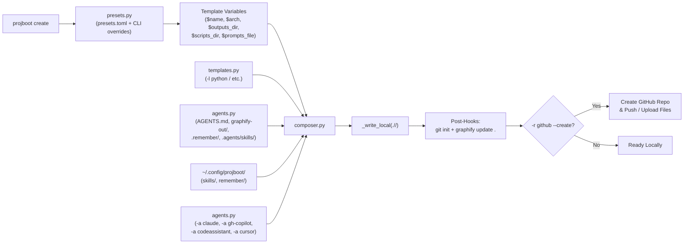

# AI Agent Project Bootstrapper (`projboot`) — Design Specification

**Date:** 2026-10-17  
**Repository:** `project-bootstrapper`  
**Status:** Draft for Review

---

## 1. Overview & Goals

Extend `project-bootstrapper` with an AI-agent-first scaffolding workflow (`projboot create`) that composes:
1. **Base language templates** (`-l python`, `python-microservice`, `typescript`, `rails`, `helm-chart`, `none`).
2. **Customizable workflow presets** (`-p / --preset` and CLI overrides `--outputs-dir`, `--scripts-dir`, `--prompts-file`, `--arch`) loaded from `~/.config/projboot/presets.toml` (or `PROJBOOT_HOME`).
3. **Universal AI agent harness** created by default in every `projboot create` project:
   - `AGENTS.md` (wired with project conventions, directory paths, and Graphify rules)
   - `graphify-out/` (initialized via `graphify update .` when available)
   - `.remember/` (populated from `~/.config/projboot/remember/` or built-in starter memory files)
   - `.agents/skills/` (populated from `~/.config/projboot/skills/` or built-in starter skill)
   - `$prompts_file` (default `PROMPTS.md`)
   - `$outputs_dir/` and `$scripts_dir/` directories
4. **Assistant-specific overlays** (`-a / --agent`, repeatable):
   - `claude` (`CLAUDE.md`, `.claude/settings.json`)
   - `gh-copilot` (`.github/copilot-instructions.md`, `.github/prompts/bootstrap.prompt.md`)
   - `codeassistant` (`.codeassistant/instructions.md`)
   - `cursor` (`.cursor/rules/project.mdc`)
5. **Local-first scaffolding & GitHub integration** (`-r github --create --clone`):
   - Always writes the scaffold locally to `./<name>/` first.
   - Initializes git (`git init -b main`) and runs `graphify update .` (unless disabled via `--no-git` / `--no-graphify`).
   - When `-r github --create` is passed, creates the remote GitHub repository and pushes the scaffold.
6. **Documentation updates**:
   - Update `README.md` with full documentation for `projboot create`, presets (`~/.config/projboot/`), `-l` languages, `-a` agent overlays, custom directory flags, and examples.

---

## 2. CLI Interface

### 2.1 Script Entrypoints (`pyproject.toml`)
Register both `project-bootstrapper` and the short alias `projboot`:
```toml
[project.scripts]
project-bootstrapper = "bootstrapper.cli:app"
projboot = "bootstrapper.cli:app"
```

### 2.2 `projboot create` Command
```bash
projboot create <name> \
  [-l / --lang <lang>] \
  [-a / --agent <agent> ...] \
  [-p / --preset <preset>] \
  [--arch <arch>] \
  [--outputs-dir <dir>] \
  [--scripts-dir <dir>] \
  [--prompts-file <file>] \
  [-r / --remote <remote>] \
  [--create] \
  [--clone] \
  [--description <text>] \
  [--private / --public] \
  [--org <org>] \
  [--license <mit|apache2|gpl3|none>] \
  [--holder <holder>] \
  [--var / -V key=value ...] \
  [--no-git] \
  [--no-graphify] \
  [--force]
```

| Option | Default | Description |
|---|---|---|
| `name` (positional or `--name`) | *(required)* | Project and target directory/repository name |
| `-l`, `--lang` | `"python"` | Base language template (`python`, `python-microservice`, `typescript`, `rails`, `helm-chart`, `none`). `python` aliases `python-microservice` |
| `-a`, `--agent` | `[]` (merged with preset) | Repeatable AI assistant overlay: `claude`, `gh-copilot`, `codeassistant`, `cursor` |
| `-p`, `--preset` | `"default"` | Preset name from `~/.config/projboot/presets.toml` (falls back to built-in `default`) |
| `--arch` | from preset (`"modular"`) | Architecture style described in agent instructions |
| `--outputs-dir` | from preset (`"outputs"`) | Directory for generated artifacts/outputs |
| `--scripts-dir` | from preset (`"scripts"`) | Directory for helper/automation scripts |
| `--prompts-file` | from preset (`"PROMPTS.md"`) | Ordered prompt log and catalog file path |
| `-r`, `--remote` | `None` | Remote provider (`"github"` when creating a remote repo) |
| `--create` | `False` | Create the remote repository on `-r github` and push |
| `--clone` | `False` | Accepted for CLI ergonomics (`-r github --create --clone`); local-first mode already leaves the cloned/initialized working tree at `./<name>/` |
| `--no-git` | `False` | Skip running `git init` locally |
| `--no-graphify` | `False` | Skip running `graphify update .` locally |
| `--force` | `False` | Allow overwriting a non-empty local target directory |

### 2.3 Preset & Config Utility Commands
- `projboot config-init [--force]`: Materializes starter `presets.toml`, `skills/project-conventions/SKILL.md`, and `remember/MEMORY.md` + `remember/decisions.md` into `PROJBOOT_HOME` (`~/.config/projboot/`).
- `projboot list-presets`: Lists available presets (combining built-in presets and user presets from `presets.toml`) with their configured `arch`, `outputs_dir`, `scripts_dir`, `prompts_file`, and `agents`.
- Existing commands (`init`, `init-from-tree`, `list-templates`) remain unchanged for backward compatibility.

---

## 3. Architecture & Module Design

### 3.1 `bootstrapper/presets.py` — Presets & User Store (`~/.config/projboot/`)
- **Config Root Resolution**: `get_config_dir() -> Path` reads `os.environ.get("PROJBOOT_HOME")` or defaults to `Path.home() / ".config" / "projboot"`.
- **Built-in Presets**:
  - `default`: `arch="modular"`, `outputs_dir="outputs"`, `scripts_dir="scripts"`, `prompts_file="PROMPTS.md"`, `agents=[]`
  - `clean-arch`: `arch="clean-architecture"`, `outputs_dir="artifacts/outputs"`, `scripts_dir="scripts"`, `prompts_file="docs/PROMPTS.md"`, `agents=["claude", "gh-copilot"]`
- **User `presets.toml` Parsing**: Uses Python 3.11 stdlib `tomllib` to load `<config_dir>/presets.toml` if present and merge on top of built-in presets.
- **Resolution Precedence**:
  `CLI flags (--outputs-dir, etc.) > User presets.toml > Built-in preset defaults`.
- **User Store Asset Loader**:
  - `load_user_store_files(config_dir: Path) -> dict[str, str]`:
    - Reads all files under `<config_dir>/skills/**` and maps them to `.agents/skills/**`.
    - Reads all files under `<config_dir>/remember/**` and maps them to `.remember/**`.
    - If Either directory is missing or empty, returns built-in starter files for `.agents/skills/project-conventions/SKILL.md` and `.remember/MEMORY.md`, `.remember/decisions.md`.

### 3.2 `bootstrapper/agents.py` — Universal Harness & Agent Overlays
Provides pure functions that return `dict[str, str]` unrendered template bodies using `string.Template` placeholders (`$name`, `$description`, `$arch`, `$outputs_dir`, `$scripts_dir`, `$prompts_file`, `$year`, `$holder`):

1. **Universal Harness (`universal_harness_files`)**:
   - `AGENTS.md`:
     - Project name, description, and architecture (`$arch`).
     - Workspace layout table mapping `$outputs_dir/`, `$scripts_dir/`, `$prompts_file`, `.remember/`, `.agents/skills/`, and `graphify-out/`.
     - Graphify usage rules (`graphify query`, `graphify path`, `graphify explain`, `graphify update .`).
   - `graphify-out/.gitkeep`: Empty marker file so the directory exists in git before or without graphify execution.
   - `$outputs_dir/.gitkeep` and `$scripts_dir/.gitkeep`.
   - `$prompts_file`: Starter Markdown file with sections for System/Architecture Prompts, Task Prompts, and Prompt History.
   - `.remember/MEMORY.md` & `.remember/decisions.md` (unless overridden by user store).
   - `.agents/skills/project-conventions/SKILL.md` (unless overridden by user store).

2. **Agent Overlays (`agent_overlay_files(agents: list[str])`)**:
   - `claude`:
     - `CLAUDE.md`: Directs Claude Code to read `AGENTS.md` and `.remember/MEMORY.md`, write outputs to `$outputs_dir/`, place scripts in `$scripts_dir/`, and track prompts in `$prompts_file`.
     - `.claude/settings.json`: Starter project settings JSON.
   - `gh-copilot`:
     - `.github/copilot-instructions.md`: GitHub Copilot repository instructions aligned with `$arch`, `$outputs_dir/`, `$scripts_dir/`, `$prompts_file`, `.remember/`, and `graphify-out/`.
     - `.github/prompts/bootstrap.prompt.md`: Reusable Copilot prompt template referencing project conventions.
   - `codeassistant`:
     - `.codeassistant/instructions.md`: Instructions for CodeAssistant tailored with project paths and architecture.
   - `cursor`:
     - `.cursor/rules/project.mdc`: Cursor rule file with frontmatter and directory conventions.

### 3.3 `bootstrapper/composer.py` — Layered File Composition & Post-Scaffold Hooks
- **`compose_project_files(...) -> dict[str, str]`**:
  1. Loads base language files from `TEMPLATES` (with `"python"` aliased to `"python-microservice"`, and `"none"` producing a minimal `README.md` + `.gitignore`).
  2. Layers universal harness files + user store files (`~/.config/projboot/skills` and `remember`).
  3. Layers each requested `-a` agent overlay in order.
  4. Adds `LICENSE` if requested.
  5. Renders all file paths and contents through `templates.render(body, **variables)` so both file bodies and dynamic paths work cleanly.
- **`run_post_hooks(target: Path, *, init_git: bool, run_graphify: bool) -> list[str]`**:
  - If `init_git`: runs `git init -b main` in `target` (captures errors gracefully as warnings if `git` is unavailable).
  - If `run_graphify`: checks `shutil.which("graphify")` or `/Users/mac/.local/bin/graphify` and runs `graphify update .` in `target` (non-fatal warning if not found).

---

## 4. Data Flow



---

## 5. Error Handling & Edge Cases

- **Unknown `-l`, `-a`, or `-p` values**: Raise `typer.BadParameter` with a clear list of valid options before touching the filesystem or network.
- **Path traversal safety**: Reuse `_safe_join(target, rel)` for all composed paths, including user-supplied `--outputs-dir`, `--scripts-dir`, `--prompts-file`, and files loaded from `~/.config/projboot/`.
- **Non-empty target directory**: Reuse `_write_local` guard (`Refusing to overwrite non-empty dir ... (use --force)`).
- **Missing external binaries (`git`, `graphify`)**: `run_post_hooks` catches `FileNotFoundError` / non-zero exit codes, logs a warning via `typer.echo`, and does not abort the bootstrap.

---

## 6. Testing & Documentation Plan

### 6.1 Automated Tests (`pytest`)
- `tests/test_presets.py`:
  - Built-in preset resolution and `presets.toml` override loading via `PROJBOOT_HOME`.
  - CLI override precedence (`--outputs-dir`, `--scripts-dir`, `--prompts-file`, `--arch`).
  - `projboot config-init` and copying/rendering custom files from `PROJBOOT_HOME/skills` and `PROJBOOT_HOME/remember`.
- `tests/test_agents.py`:
  - Universal harness files (`AGENTS.md`, `graphify-out/.gitkeep`, `.remember/MEMORY.md`, `.agents/skills/...`, custom `PROMPTS.md`).
  - Each `-a` overlay (`claude`, `gh-copilot`, `codeassistant`, `cursor`) and multi-agent combination (`-a claude -a gh-copilot`).
- `tests/test_cli.py`:
  - `projboot create new-project -l python -a claude -a gh-copilot` local execution.
  - `projboot create new-project -l python -a claude -a gh-copilot -r github --create --clone` with mocked GitHub & subprocess calls.

### 6.2 Documentation (`README.md`)
- Document both `projboot` and `project-bootstrapper` CLI entrypoints.
- Add an **AI Agent Project Bootstrapping** section showing:
  - `projboot create` quickstart (`projboot create new-project -l python -a claude -a gh-copilot -r github --create --clone`)
  - What gets generated in the Universal Agent Harness (`AGENTS.md`, `graphify-out/`, `.remember/`, `.agents/skills/`, `PROMPTS.md`)
  - Supported `-a` assistant adapters
  - Customizing presets and personal skills/memory templates in `~/.config/projboot/` (`projboot config-init`, `projboot list-presets`).
